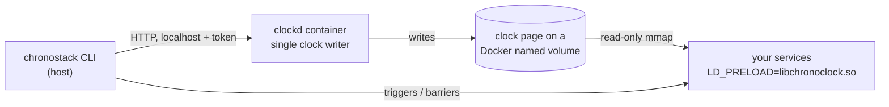

# ChronoStack

**Stripe Test Clocks for your Docker Compose stack.**
Move the whole stack — Postgres, Redis, and your services — forward in time together, run the scheduled jobs that depend on it, and check the results.

> [!IMPORTANT]
> **Status: design phase (pre-alpha). There is no runnable code yet.**
> This repository contains the research, architecture and implementation plan for ChronoStack, plus a throwaway feasibility spike. Every `chronostack` command in this README is **proposed**, not implemented.
> **M0 feasibility spike: gate passed on Docker Desktop/WSL2 x86_64** ([results](docs/M0_RESULTS.md)). Shared virtual time worked across Postgres, Redis, Node, Python and the JVM, with zero hangs and about 13 ns overhead per clock read. macOS and arm64 have not been tested yet.

---

## The problem

Time-dependent behaviour is some of the least-tested code in SaaS products. Examples:

- trials that expire
- sessions and tokens that time out
- subscription renewals and dunning
- data-retention purges
- webhook retries with backoff

Teams usually test this by:

- editing timestamps in the database by hand;
- adding test-only endpoints;
- shortening durations with environment flags;
- or waiting real days in staging.

None of these exercise the real interaction between database time (`now()`), cache expiry (Redis TTLs), schedulers and multiple services.

## What ChronoStack will do (planned for v0.1)

- **Shared virtual wall-clock time across your Compose services, with no code changes.** A small preload library makes `NOW()` in Postgres, Redis expiry, `Date.now()` in Node and `time.time()` in Python all report the same virtual time.
- **Advancing time actually runs scheduled work.** Changing the clock alone does *not* fire your timers ([why](docs/TECHNICAL_FEASIBILITY.md#313-virtual-wall-clock-time-vs-virtual-monotonic-time)). So each step works like this:
  1. advance the clock;
  2. run the triggers you declare (a command or HTTP call);
  3. wait on barriers (conditions such as "the jobs table is idle") before the next step.
- **Verification after every step.** Probes check that each service sees the new time. `doctor` reports which services cannot be virtualized, and why.
- **Outages scheduled in virtual time.** For example, "the webhook receiver is down on day 3 from 09:00 to 11:00", so you can test retries.
- **Scenarios and failure reports.** Declarative YAML steps with SQL, Redis and HTTP assertions. Each run writes a JSON report.
- **MCP server.** AI coding agents can control the timeline through a small, safe set of tools.

### Proposed workflow (not implemented)

```console
$ chronostack up                      # wraps your existing docker-compose.yml
$ chronostack doctor                  # shows which services are virtualized
$ chronostack advance 25h             # Redis session expires; trial still active
$ chronostack advance 14d --step 1d   # daily job runs 14 times; trial expires
$ chronostack run scenarios/trial.yml # pass/fail + .chronostack/report-<run>.json
```

## How it works



- **Preload library (`libchronoclock`).** A small C library, loaded into each process with `LD_PRELOAD`. It reads a shared clock page through a lock-free sequence counter (a seqlock) and adds the virtual offset to wall-clock reads.
  - Monotonic clocks are never changed.
  - Absolute wall-clock deadlines are converted back to real time, so lock and semaphore timeouts don't hang.
- **Controller (`clockd`).** A container that is the only writer of the clock page. It runs inside the Docker VM, so the design works the same on Linux, macOS and Windows.
- **CLI.** Reads your Compose project and generates an override file. It never edits your files or Dockerfiles. It also runs the step / trigger / barrier engine.

Details: [Architecture](docs/ARCHITECTURE.md) · [Decisions](docs/ARCHITECTURE_DECISIONS.md) · [Feasibility research](docs/TECHNICAL_FEASIBILITY.md) · [Source verification](docs/SOURCE_VERIFICATION.md)

## How it differs from existing tools

| Tool | What it does | What ChronoStack adds |
|---|---|---|
| [libfaketime](https://github.com/wolfcw/libfaketime) | Fakes time per process with `LD_PRELOAD` | Live control across containers, verification probes, safe deadline handling, scheduler-aware stepping |
| [Stripe Test Clocks](https://docs.stripe.com/billing/testing/test-clocks) | Simulated time for Stripe Billing objects | The same idea applied to *your* database, cache and jobs |
| Fake timers (Node `MockTimers`, freezegun, time-machine) | In-process time for unit tests | Integration across processes and services |
| [Toxiproxy](https://github.com/Shopify/toxiproxy) | TCP fault injection in real time | Faults scheduled on the virtual timeline |

The time-faking mechanism itself is not new. The value is in the orchestration, safety and lifecycle workflow. Full analysis: [docs/COMPETITIVE_ANALYSIS.md](docs/COMPETITIVE_ANALYSIS.md).

## Target compatibility for v0.1

Nothing is supported until automated tests prove it ([testing strategy](docs/TESTING_STRATEGY.md)).

| Component | v0.1 target |
|---|---|
| PostgreSQL 16 (Debian, Alpine), including pg_cron | Planned |
| Redis 7 (Debian, Alpine) | Planned |
| Node.js 20/22, Python 3.10+ (wall-clock time) | Planned |
| JVM 17/21, Ruby 3.x | Experimental |
| Go, statically linked binaries, setuid binaries | **Not supported** (`LD_PRELOAD` cannot reach them) |
| Hosts: Linux x86_64/arm64 (Docker Engine), macOS arm64 (Docker Desktop, OrbStack), Windows x64 (Docker Desktop) | Planned |

## Known limitations (by design)

- Time only moves **forward**.
- Application timers (`setTimeout`, `asyncio.sleep`, node-cron, APScheduler) do not fire early. Use triggers.
- Postgres `now()` is fixed for the length of a transaction.
- Go and statically linked programs are not virtualized.
- Data written with virtual timestamps stays in ChronoStack's volumes.

Full list: [docs/RISKS_AND_LIMITATIONS.md](docs/RISKS_AND_LIMITATIONS.md)

## Security

ChronoStack never changes your host's clock, needs no privileged containers, and never gives a container the Docker socket. Its control API listens only on localhost and requires a token. See [SECURITY.md](SECURITY.md) and [docs/SECURITY_AND_RELIABILITY.md](docs/SECURITY_AND_RELIABILITY.md).

## Roadmap

| Version | Focus |
|---|---|
| **M0 (done, see [results](docs/M0_RESULTS.md))** | Feasibility spike:<br>• correct time in Postgres, Redis, Node and Python<br>• no hangs<br>• on Linux and Docker Desktop for Mac, with glibc and musl |
| v0.1 | Preload library, controller, CLI, step / trigger / barrier engine, reference SaaS demo, outage windows, scenarios, reports, MCP |
| v0.2 | Virtual user cohorts, seeded network faults, npm package and JS SDK, scheduler inspection, GitHub Action |
| v1.0 | Snapshot and restore (which would allow moving backward in time), timeline viewer, investigation of Go support |

Details: [docs/FEATURE_ROADMAP.md](docs/FEATURE_ROADMAP.md) · [docs/IMPLEMENTATION_PLAN.md](docs/IMPLEMENTATION_PLAN.md)

## Contributing

The project is in the design phase. The most useful contributions right now:

- reviewing the [architecture decisions](docs/ARCHITECTURE_DECISIONS.md);
- pointing out wrong technical claims in the [feasibility research](docs/TECHNICAL_FEASIBILITY.md);
- sharing how you test time-dependent behaviour today.

See [CONTRIBUTING.md](CONTRIBUTING.md) and the [Code of Conduct](CODE_OF_CONDUCT.md).

## License

Licensed under either of

- Apache License, Version 2.0 ([LICENSE-APACHE](LICENSE-APACHE))
- MIT license ([LICENSE-MIT](LICENSE-MIT))

at your option.

Unless you explicitly state otherwise, any contribution intentionally submitted for inclusion in the work by you, as defined in the Apache-2.0 license, shall be dual licensed as above, without any additional terms or conditions.

## Documentation

Start at the [documentation index](docs/README.md).
