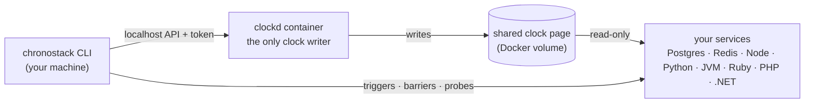

<div align="center">

<h1>
  <picture>
    <source media="(prefers-color-scheme: dark)" srcset="docs/assets/brand/chronostack-logo-dark.svg">
    <source media="(prefers-color-scheme: light)" srcset="docs/assets/brand/chronostack-logo-light.svg">
    
  </picture>
</h1>

**Stripe Test Clocks for your Docker Compose stack.**

Move Postgres, Redis and your services forward in time together, run the jobs that depend on it, and verify what happened. No code changes.

[](https://github.com/Asmodeus14/ChronoStack/releases)
[](https://github.com/Asmodeus14/ChronoStack/actions/workflows/ci.yml)
[](#license)

[](https://glama.ai/mcp/servers/Asmodeus14/ChronoStack)

[Getting started](docs/GETTING_STARTED.md) · [Guide](docs/GUIDE.md) · [Demo](examples/saas-trial-demo/README.md) · [Docs](docs/README.md)


▶ [Watch the 50-second demo video](docs/assets/demo/chronostack-demo.mp4) (1080p, recorded with the published release)

</div>

> [!NOTE]
> **Alpha.** The latest release, [`v0.1.0-alpha.10`](https://github.com/Asmodeus14/ChronoStack/releases/tag/v0.1.0-alpha.10), is tested in CI on Linux (x86_64 and arm64) and on macOS (Intel, Docker in a Linux VM), and by hand on Windows. On Apple-silicon Macs, the installer and the native CLI are tested in CI, but **running containers there is untested:** if you have one, [issue #5](https://github.com/Asmodeus14/ChronoStack/issues/5) has a 5-minute test.

## Why

Trials that expire, sessions that time out, renewals, dunning, retention purges, webhook retries: time-dependent code is some of the least-tested code in any SaaS product. It's usually tested by editing timestamps in the database, shortening durations with a flag, or not at all. None of these exercises the real interaction between the database's `now()`, Redis expiry, your schedulers and your services.

ChronoStack gives your whole stack one virtual clock that you control:

```console
$ chronostack up --wait          # a copy of your compose stack, on a virtual clock
$ chronostack advance 14d        # 14 days later in Postgres, Redis, Node, Python, …
                                 # and your nightly job ran at each virtual 03:00
$ chronostack run scenarios/trial.yml   # a scripted, repeatable test with a report
```


## Quickstart

**1. Install.** You need Docker with Compose v2. No admin rights needed.

```sh
# Linux / macOS
curl -fsSL https://github.com/Asmodeus14/ChronoStack/releases/download/v0.1.0-alpha.10/install.sh | CHRONOSTACK_VERSION=0.1.0-alpha.10 sh
```

```powershell
# Windows (PowerShell)
$env:CHRONOSTACK_VERSION = "0.1.0-alpha.10"; irm https://github.com/Asmodeus14/ChronoStack/releases/download/v0.1.0-alpha.10/install.ps1 | iex
```

Or with a package manager:

```sh
# Homebrew (macOS, Linux)
brew install asmodeus14/tap/chronostack
```

```powershell
# Scoop (Windows)
scoop bucket add chronostack https://github.com/Asmodeus14/scoop-bucket
scoop install chronostack/chronostack
```

**2. Run the demo:** a small SaaS app with a 14-day trial, a nightly job and webhooks.

```sh
git clone https://github.com/Asmodeus14/ChronoStack && cd ChronoStack/examples/saas-trial-demo
chronostack up --wait
chronostack advance 15d        # the trial expires at the nightly job
chronostack run scenarios/trial.yml
```

**3. Use it on your project:** `cd` to your compose project and run `chronostack init` (a starter `chronostack.yml` for your schedulers and queues), then `chronostack up --wait` and `chronostack doctor`. Then follow **[Getting started](docs/GETTING_STARTED.md)**, a 10-minute walkthrough with a cheat sheet and FAQ.

Update any time with `chronostack update`. The installer verifies checksums and puts `chronostack` on your PATH; [details and uninstall](docs/GETTING_STARTED.md#1-install).

## How it works



1. **One clock for every service.** A small C library loaded with `LD_PRELOAD` makes wall-clock reads (`now()`, `Date.now()`, `time.time()`, Redis expiry) return virtual time. It adds about 12–16 ns per read in C and 10–26 ns in Python and Node, measured on three machines ([benchmarks](bench/README.md)). Monotonic clocks are left alone, and absolute deadlines are translated back to real time, so the timed waits behind locks and timeouts return on time instead of hanging. That's checked in C, Python, Node and the JVM ([results](docs/M0_RESULTS.md)), and re-run every night in CI.
2. **Moving the clock runs your scheduled work.** Changing the clock doesn't fire timers ([why](docs/TECHNICAL_FEASIBILITY.md#313-virtual-wall-clock-time-vs-virtual-monotonic-time)). So `advance` stops at each interesting virtual time, runs the **triggers** you declare (e.g. "the nightly job at 03:00"), and waits on **barriers** (e.g. "the queue is empty") before moving on. pg_cron is detected and handled automatically.
3. **Everything is verified.** After each advance, every service is probed to confirm it sees the new time, and `doctor` explains anything it can't reach, including a container still running the shim from an older ChronoStack version after an upgrade.

### Scenarios: repeatable tests in virtual time

Script the story, including an outage of an HTTP dependency in **virtual time**, and assert the outcome (this is the scenario in the demo above):

```yaml
steps:
  - fault: { target: webhooks, from: +14d2h, for: 4h }   # partner down on day 14, 02:00–06:00
  - advance: 14d
  - advance: { by: 12h, step: 1h }
  - assert: { redis: { service: cache, command: [HGET, webhook:received, "trial.expired:${user_id}"], equals: "1" } }
```

### Failure reports a newcomer can read

When something breaks, the Markdown report says what was expected, what happened, and what the services did:


## Features

- **No code changes:** works on your existing `compose.yml`, as a separate copy with its own containers and named volumes, and leaves your files untouched. Bind mounts and external volumes can't be copied, so `up` stops if one is writable instead of letting the copy change your real data.
- **Scheduler-aware stepping:** triggers run at their exact virtual times. BullMQ and Celery beat fire on their own. For pg_cron, the clock stops on each job's minute so fixed-time jobs run; jobs like `*/5 * * * *` run once per stop unless you pass `--pg-cron-all`.
- **Waits for your jobs:** built-in `bullmq`, `sidekiq` and `celery` barriers hold each step until the queues are drained, and running jobs finish before the clock moves. For Celery, `restart_on_jump` makes ETA/countdown tasks run once after a jump instead of waiting in real time.
- **Outages, errors and latency in virtual time:** a small proxy in front of HTTP dependencies (`http` or `https`) makes "the payment API is down on day 3 from 09:00 to 11:00" a one-liner, or "slow and failing 30% of the time" with a seeded, repeatable `--rate` and `--delay`.
- **Scenarios and reports:** YAML steps with SQL, Redis, HTTP and exec checks. JSON, Markdown and JUnit reports, with secrets redacted. `chronostack report list`, `show` and `diff` read runs back and show what changed between two of them.
- **Reach the copy from your machine:** `expose: [api:3000]` publishes chosen ports of the copy on `127.0.0.1`, for your browser, scripts and simulated users.
- **Simulated users:** `chronostack users run` sends seeded cohorts of users through scripted journeys (requests, think times, branches) and reports failures and latency per step ([guide](docs/GUIDE.md#8-simulated-users)).
- **CI ready:** exit codes, a [GitHub Action](docs/GUIDE.md#9-in-ci), and a strict mode.
- **AI agents:** `chronostack mcp` is an MCP server with a fixed, safe set of 17 tools: inspect the stack, move time, schedule outages, run scenarios with simulated users and compare runs (`claude mcp add chronostack -- chronostack mcp --project-dir <project>`; [Cursor, Gemini CLI](docs/GUIDE.md#10-ai-agents-mcp)).
- **Host-native Node and Playwright:** `node -r chronostack/register app.js` puts a Node process outside Docker on the same clock, and `syncClock(page)` from `chronostack/playwright` does the same for the browser in your Playwright tests. `npm install --save-dev chronostack` ([details](sdk/node/README.md)).
- **Safe by design:** never changes the host clock, needs no privileged containers, gives no container the Docker socket, and its API is local-only with a token.

## Compatibility

Listed as tested only where an automated test covers it.

| Component | Status |
|---|---|
| PostgreSQL 16 (Debian, Alpine), including pg_cron · Redis 7 (Debian, Alpine) | ✅ Tested in CI |
| Node.js 22 · Python 3.10 / 3.12 (Debian, Alpine) | ✅ Tested in CI, plus a nightly no-hang suite |
| JVM 17 / 21 · Ruby 3.3 · PHP 8.3 · .NET 8 | ✅ Nightly no-hang suite and clock check; not yet tried on real apps |
| Node.js 20, Python 3.13+, MariaDB | Expected to work; not covered by tests |
| BullMQ, Celery beat (`beat_max_loop_interval ≤ 1`), pg_cron | ✅ Work without triggers (measured) |
| Celery beat crontab tasks under django-celery-beat's `DatabaseScheduler` | ⚠️ May not fire after a jump; use triggers ([#9](https://github.com/Asmodeus14/ChronoStack/issues/9)) |
| BullMQ, Sidekiq and Celery barriers | ✅ Nightly, with real workers (x86_64 and arm64) |
| node-cron, APScheduler, Spring `@Scheduled`, Laravel `schedule:work`, sidekiq-cron, `setTimeout`-style loops | Need a trigger (measured) |
| Go and other static or setuid binaries | ❌ Not supported (`LD_PRELOAD` can't reach them); flagged by `doctor` |
| Hosts: Linux x86_64 / arm64 · Windows 11 (Docker Desktop) | ✅ CI · tested by hand |
| Host: macOS Intel (native CLI, Docker in a Linux VM) | ✅ CI (nightly, Colima) |
| Host: macOS Apple silicon: installer and native CLI | ✅ CI (release install test) |
| Host: macOS Apple silicon: running containers (Docker Desktop, OrbStack) | ❓ Untested ([help wanted](https://github.com/Asmodeus14/ChronoStack/issues/5)) |

**Limitations:**
- Time only moves forward.
- App timers don't fire early; use triggers.
- Postgres `now()` is fixed within a transaction.
- Outage URLs must come from environment variables.

[Full list](docs/RISKS_AND_LIMITATIONS.md).

## How it compares

| Tool | What it does | What ChronoStack adds |
|---|---|---|
| [libfaketime](https://github.com/wolfcw/libfaketime) | Fakes time per process (`LD_PRELOAD`) | Live control across containers, deadline safety, scheduler-aware stepping, probes, outages, scenarios |
| [Stripe Test Clocks](https://docs.stripe.com/billing/testing/test-clocks) | Simulated time for Stripe objects | The same idea for *your* database, cache and jobs |
| Fake timers (Node `MockTimers`, freezegun, time-machine) | In-process time for unit tests | Integration across processes and services |
| [Toxiproxy](https://github.com/Shopify/toxiproxy) | TCP faults in real time | Outages scheduled on the virtual timeline |

Faking the time isn't new; the orchestration, safety and lifecycle workflow are what ChronoStack adds. [Full analysis](docs/COMPETITIVE_ANALYSIS.md).

## Found in real projects

Each bug was reproduced on the project's own published image, with the whole stack's clock moved forward, and reported upstream. Thanks to the maintainers for their work and their time.

| Project | What was wrong | Status |
|---|---|---|
| Saleor | Unpaid orders set to expire after a day or more expired far too late: 24 h became about 47.6 h, and 48 h about 62 days. | Fix proposed · [issue](https://github.com/saleor/saleor/issues/20019) · [PR](https://github.com/saleor/saleor/pull/20020) |
| Twenty | The trash cleanup permanently deleted records up to a day before the retention period ended. | Fixed · [issue](https://github.com/twentyhq/twenty/issues/30460) · [PR](https://github.com/twentyhq/twenty/pull/30461) |
| Chatwoot | Conversations whose snooze ended while background jobs were down for more than 3 days were never reopened. | Confirmed by maintainers · [issue](https://github.com/chatwoot/chatwoot/issues/16667) · [community fix PR](https://github.com/chatwoot/chatwoot/pull/16679) |
| Formbricks | With a scheduling time zone at UTC+12 or later, such as New Zealand, surveys opened and closed a day late. | Confirmed by maintainers · [issue](https://github.com/formbricks/formbricks/issues/10021) |
| tududi | Monthly recurring tasks moved to the wrong day: for users in the Americas, "on the 1st" became the last day of the previous month, and "last Friday" skipped months. | Fixed · [issue](https://github.com/chrisvel/tududi/issues/2100) · [PR](https://github.com/chrisvel/tududi/pull/2101) |
| Worklenz | Monthly "Nth weekday" recurring tasks landed on the wrong date: "1st Monday" moved back into the previous month and then stopped recurring, and "2nd Tuesday" came a week early. | Fixed · [issue](https://github.com/Worklenz/worklenz/issues/959) · [PR](https://github.com/Worklenz/worklenz/pull/960) |

The setups, scenarios and run reports are in [docs/launch/outreach](docs/launch/outreach/).

## Documentation

| | |
|---|---|
| [Getting started](docs/GETTING_STARTED.md) | Install, demo, your first project, cheat sheet, FAQ |
| [Guide](docs/GUIDE.md) | `doctor`, triggers, barriers, outages, scenarios, CI, troubleshooting |
| [Demo app](examples/saas-trial-demo/README.md) | The SaaS example used above |
| [Architecture](docs/ARCHITECTURE.md) · [Decisions](docs/ARCHITECTURE_DECISIONS.md) | How it works, and why |
| [Project status](docs/IMPLEMENTATION_PLAN.md) | Milestones M0–M5 and their test results |
| [All documents](docs/README.md) | The index |

## Contributing

The most useful help right now:
- Try `chronostack up --wait && chronostack doctor` on your own compose project and [tell us what breaks](https://github.com/Asmodeus14/ChronoStack/issues). Include the `doctor` output.
- Run the macOS test in [#5](https://github.com/Asmodeus14/ChronoStack/issues/5).
- Share how you test time-dependent code today.

See [CONTRIBUTING.md](CONTRIBUTING.md) to build from source, and the [Code of Conduct](CODE_OF_CONDUCT.md). Security issues go through [SECURITY.md](SECURITY.md), not public issues. Accessibility barriers are bugs: see [ACCESSIBILITY.md](ACCESSIBILITY.md).

## License

Licensed under either of [Apache License, Version 2.0](LICENSE-APACHE) or [MIT license](LICENSE-MIT), at your option. Unless you explicitly state otherwise, any contribution intentionally submitted for inclusion in the work by you, as defined in the Apache-2.0 license, shall be dual licensed as above, without any additional terms or conditions.
