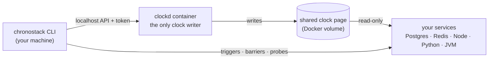

<div align="center">

<h1>
  <picture>
    <source media="(prefers-color-scheme: dark)" srcset="docs/assets/brand/chronostack-logo-dark.svg">
    <source media="(prefers-color-scheme: light)" srcset="docs/assets/brand/chronostack-logo-light.svg">
    
  </picture>
</h1>

**Stripe Test Clocks for your Docker Compose stack.**

Move Postgres, Redis and your services forward in time together, run the jobs that depend on it, and verify what happened. No code changes.

[](https://github.com/Asmodeus14/ChronoStack/releases)
[](https://github.com/Asmodeus14/ChronoStack/actions/workflows/ci.yml)
[](#license)
-lightgrey)

[Getting started](docs/GETTING_STARTED.md) · [Guide](docs/GUIDE.md) · [Demo](examples/saas-trial-demo/README.md) · [Docs](docs/README.md)


</div>

> [!NOTE]
> **Pre-alpha.** The first pre-release, [`v0.1.0-alpha.2`](https://github.com/Asmodeus14/ChronoStack/releases/tag/v0.1.0-alpha.2), is tested in CI on Linux (x86_64 and arm64) and by hand on Windows. **macOS is untested:** if you have a Mac, [issue #5](https://github.com/Asmodeus14/ChronoStack/issues/5) has a 5-minute test.

## Why

Trials that expire, sessions that time out, renewals, dunning, retention purges, webhook retries: time-dependent code is some of the least-tested code in any SaaS product. It's usually tested by editing timestamps in the database, shortening durations with a flag, or not at all. None of these exercises the real interaction between the database's `now()`, Redis expiry, your schedulers and your services.

ChronoStack gives your whole stack one virtual clock that you control:

```console
$ chronostack up --wait          # a copy of your compose stack, on a virtual clock
$ chronostack advance 14d        # 14 days later in Postgres, Redis, Node, Python, …
                                 # and your nightly job ran at each virtual 03:00
$ chronostack run scenarios/trial.yml   # a scripted, repeatable test with a report
```

## Quickstart

**1. Install.** You need Docker with Compose v2. No admin rights needed.

```sh
# Linux / macOS
curl -fsSL https://github.com/Asmodeus14/ChronoStack/releases/download/v0.1.0-alpha.2/install.sh | CHRONOSTACK_VERSION=0.1.0-alpha.2 sh
```

```powershell
# Windows (PowerShell)
$env:CHRONOSTACK_VERSION = "0.1.0-alpha.2"; irm https://github.com/Asmodeus14/ChronoStack/releases/download/v0.1.0-alpha.2/install.ps1 | iex
```

**2. Run the demo:** a small SaaS app with a 14-day trial, a nightly job and webhooks.

```sh
git clone https://github.com/Asmodeus14/ChronoStack && cd ChronoStack/examples/saas-trial-demo
chronostack up --wait
chronostack advance 15d        # the trial expires at the nightly job
chronostack run scenarios/trial.yml
```

**3. Use it on your project:** `cd` to your compose project and run `chronostack up --wait` and `chronostack doctor`. Then follow **[Getting started](docs/GETTING_STARTED.md)**, a 10-minute walkthrough with a cheat sheet and FAQ.

Update any time with `chronostack update`. The installer verifies checksums and puts `chronostack` on your PATH; [details and uninstall](docs/GETTING_STARTED.md#1-install).

## How it works



1. **One clock for every service.** A small C library loaded with `LD_PRELOAD` makes wall-clock reads (`now()`, `Date.now()`, `time.time()`, Redis expiry) return virtual time. It adds about 13 ns per read. Monotonic clocks are left alone, and absolute deadlines are translated back to real time, so locks and timeouts never hang.
2. **Moving the clock runs your scheduled work.** Changing the clock doesn't fire timers ([why](docs/TECHNICAL_FEASIBILITY.md#313-virtual-wall-clock-time-vs-virtual-monotonic-time)). So `advance` stops at each interesting virtual time, runs the **triggers** you declare (e.g. "the nightly job at 03:00"), and waits on **barriers** (e.g. "the queue is empty") before moving on. pg_cron is detected and handled automatically.
3. **Everything is verified.** After each advance, every service is probed to confirm it sees the new time, and `doctor` explains anything it can't reach.

### Scenarios: repeatable tests in virtual time

Script the story, including an outage of an HTTP dependency in **virtual time**, and assert the outcome:


```yaml
steps:
  - fault: { target: webhooks, from: +14d2h, for: 4h }   # partner down on day 14, 02:00–06:00
  - advance: 14d
  - advance: { by: 12h, step: 1h }
  - assert: { redis: { service: cache, command: [HGET, webhook:received, "trial.expired:${user_id}"], equals: "1" } }
```

### Failure reports a newcomer can read

When something breaks, the Markdown report says what was expected, what happened, and what the services did:


## Features

- **No code changes:** works on your existing `compose.yml`, as a separate copy. Your containers, data and files are untouched.
- **Scheduler-aware stepping:** triggers run at their exact virtual times. BullMQ and Celery beat fire on their own, and pg_cron jobs are never skipped.
- **Outages in virtual time:** a small proxy in front of HTTP dependencies (`http` or `https`) makes "the payment API is down on day 3 from 09:00 to 11:00" a one-liner.
- **Scenarios and reports:** YAML steps with SQL, Redis, HTTP and exec checks. JSON and Markdown reports, with secrets redacted.
- **CI ready:** exit codes, a [GitHub Action](docs/GUIDE.md#8-in-ci), and a strict mode.
- **AI agents:** `chronostack mcp` is an MCP server with a fixed, safe tool set (`claude mcp add chronostack -- chronostack mcp --project-dir <project>`).
- **Host-native Node:** `node -r sdk/node/register.js app.js` puts a Node process outside Docker on the same clock ([details](sdk/node/README.md)).
- **Safe by design:** never changes the host clock, needs no privileged containers, gives no container the Docker socket, and its API is local-only with a token.

## Compatibility

Listed as tested only where an automated test covers it.

| Component | Status |
|---|---|
| PostgreSQL 16 (Debian, Alpine), including pg_cron · Redis 7 (Debian, Alpine) | ✅ Tested in CI |
| Node.js 22 · Python 3.10 / 3.12 (Debian, Alpine) | ✅ Tested in CI, plus a nightly no-hang suite |
| JVM 21 | ✅ No-hang suite; otherwise experimental |
| Node.js 20, Python 3.13+, JVM 17, Ruby 3.x, MariaDB | Expected to work; not covered by tests |
| BullMQ, Celery beat (`beat_max_loop_interval ≤ 1`), pg_cron | ✅ Work without triggers (measured) |
| node-cron, APScheduler, `setTimeout`-style loops | Need a trigger (measured) |
| Go and other static or setuid binaries | ❌ Not supported (`LD_PRELOAD` can't reach them); flagged by `doctor` |
| Hosts: Linux x86_64 / arm64 · Windows 11 (Docker Desktop) | ✅ CI · tested by hand |
| Host: macOS (Docker Desktop, OrbStack) | ❓ Untested ([help wanted](https://github.com/Asmodeus14/ChronoStack/issues/5)) |

**Limitations:**
- Time only moves forward.
- App timers don't fire early; use triggers.
- Postgres `now()` is fixed within a transaction.
- Outage URLs must come from environment variables.

[Full list](docs/RISKS_AND_LIMITATIONS.md).

## How it compares

| Tool | What it does | What ChronoStack adds |
|---|---|---|
| [libfaketime](https://github.com/wolfcw/libfaketime) | Fakes time per process (`LD_PRELOAD`) | Live control across containers, deadline safety, scheduler-aware stepping, probes, outages, scenarios |
| [Stripe Test Clocks](https://docs.stripe.com/billing/testing/test-clocks) | Simulated time for Stripe objects | The same idea for *your* database, cache and jobs |
| Fake timers (Node `MockTimers`, freezegun, time-machine) | In-process time for unit tests | Integration across processes and services |
| [Toxiproxy](https://github.com/Shopify/toxiproxy) | TCP faults in real time | Outages scheduled on the virtual timeline |

Faking the time isn't new; the orchestration, safety and lifecycle workflow are what ChronoStack adds. [Full analysis](docs/COMPETITIVE_ANALYSIS.md).

## Documentation

| | |
|---|---|
| [Getting started](docs/GETTING_STARTED.md) | Install, demo, your first project, cheat sheet, FAQ |
| [Guide](docs/GUIDE.md) | `doctor`, triggers, barriers, outages, scenarios, CI, troubleshooting |
| [Demo app](examples/saas-trial-demo/README.md) | The SaaS example used above |
| [Architecture](docs/ARCHITECTURE.md) · [Decisions](docs/ARCHITECTURE_DECISIONS.md) | How it works, and why |
| [Project status](docs/IMPLEMENTATION_PLAN.md) | Milestones M0–M5 and their test results |
| [All documents](docs/README.md) | The index |

## Contributing

The most useful help right now:
- Try `chronostack up --wait && chronostack doctor` on your own compose project and [tell us what breaks](https://github.com/Asmodeus14/ChronoStack/issues). Include the `doctor` output.
- Run the macOS test in [#5](https://github.com/Asmodeus14/ChronoStack/issues/5).
- Share how you test time-dependent code today.

See [CONTRIBUTING.md](CONTRIBUTING.md) to build from source, and the [Code of Conduct](CODE_OF_CONDUCT.md). Security issues go through [SECURITY.md](SECURITY.md), not public issues.

## License

Licensed under either of [Apache License, Version 2.0](LICENSE-APACHE) or [MIT license](LICENSE-MIT), at your option. Unless you explicitly state otherwise, any contribution intentionally submitted for inclusion in the work by you, as defined in the Apache-2.0 license, shall be dual licensed as above, without any additional terms or conditions.
