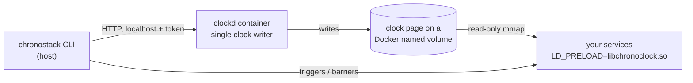

# ChronoStack

**Stripe Test Clocks for your Docker Compose stack.**
Move the whole stack — Postgres, Redis, and your services — forward in time together, run the scheduled jobs that depend on it, and check the results.

> [!IMPORTANT]
> **Status: pre-alpha. Usable from source on Linux and Windows hosts; not released.**
> - **M0 feasibility spike: passed** ([results](docs/M0_RESULTS.md)). Virtual time worked across Postgres, Redis, Node, Python and the JVM, with zero hangs and about 13 ns overhead per clock read.
> - **M1 (controller + core CLI): implemented.** `up`, `down`, `now`, `advance`, `freeze`, `unfreeze`, `probe` and `doctor` work. They are tested end to end in CI on Linux x86_64 and arm64, and locally on Docker Desktop (Windows).
> - **M2 (step → trigger → barrier engine): implemented.** `chronostack.yml` triggers and barriers, scheduled triggers in virtual time, automatic pg_cron sub-stepping, `--dry-run`, and a [reference demo](examples/saas-trial-demo/README.md). In the demo, `advance 14d` runs the daily job 14 times in about 17 s ([results](docs/M2_RESULTS.md)).
> - Outage windows, scenarios and MCP are **planned** (M3–M4). macOS is untested.

---

## The problem

Time-dependent behaviour is some of the least-tested code in SaaS products. Examples:

- trials that expire
- sessions and tokens that time out
- subscription renewals and dunning
- data-retention purges
- webhook retries with backoff

Teams usually test this by:

- editing timestamps in the database by hand;
- adding test-only endpoints;
- shortening durations with environment flags;
- or waiting real days in staging.

None of these exercise the real interaction between database time (`now()`), cache expiry (Redis TTLs), schedulers and multiple services.

## What ChronoStack does

Items marked *(planned)* are not built yet.

- **Shared virtual wall-clock time across your Compose services, with no code changes.** A small preload library makes `NOW()` in Postgres, Redis expiry, `Date.now()` in Node and `time.time()` in Python all report the same virtual time.
- **Advancing time actually runs scheduled work.** Changing the clock alone does *not* fire your timers ([why](docs/TECHNICAL_FEASIBILITY.md#313-virtual-wall-clock-time-vs-virtual-monotonic-time)). So each step works like this:
  1. advance the clock;
  2. run the triggers you declare (a command or HTTP call);
  3. wait on barriers (conditions such as "the jobs table is idle") before the next step.
- **Scheduler-aware stepping.** Scheduled triggers run at their exact virtual times. pg_cron is detected, and the clock stops on each of its job minutes so jobs aren't skipped.
- **Verification after every step.** Probes check that each service sees the new time. `doctor` reports which services cannot be virtualized, and why.
- *(planned, M3)* **Outages scheduled in virtual time.** For example, "the webhook receiver is down on day 3 from 09:00 to 11:00", so you can test retries.
- *(planned, M3)* **Scenarios and failure reports.** Declarative YAML steps with SQL, Redis and HTTP assertions. Each run writes a JSON report.
- *(planned, M4)* **MCP server.** AI coding agents can control the timeline through a small, safe set of tools.

### Workflow

Commands marked *(planned)* are not implemented yet. Scheduled work is declared once in `chronostack.yml`:

```yaml
version: 1
triggers:
  - name: expire-trials
    schedule: { every: 1d, at: "03:00" }        # virtual time, UTC
    exec: { service: worker, command: [node, src/jobs/expire-trials.js] }
```

```console
$ chronostack up                      # wraps your existing docker-compose.yml
$ chronostack doctor                  # shows which services are virtualized
$ chronostack advance 25h             # Redis session expires; trial still active
$ chronostack advance 14d             # daily 03:00 trigger runs 14 times; trial expires on day 14
$ chronostack run scenarios/trial.yml # (planned, M3) pass/fail + .chronostack/report-<run>.json
```

### Try it from source (pre-alpha)

You need Docker with Compose v2, and a stable Rust toolchain.

```sh
git clone https://github.com/Asmodeus14/ChronoStack && cd ChronoStack
docker build -f docker/clockd.Dockerfile -t chronostack/clockd:dev .   # controller image
cargo install --path crates/cli                                         # installs `chronostack`

cd /path/to/your/compose/project
chronostack up --wait     # same compose file, no changes needed; waits until every service sees virtual time
chronostack doctor        # what is virtualized, and why not
chronostack advance 7d    # moves time and verifies every service sees it
chronostack down -v
```

ChronoStack runs your project under a **separate** Compose project name (`<name>-chronostack`) with its own volumes. Your normal stack and its data are untouched, and your compose files are never modified.

## How it works



- **Preload library (`libchronoclock`).** A small C library, loaded into each process with `LD_PRELOAD`. It reads a shared clock page through a lock-free sequence counter (a seqlock) and adds the virtual offset to wall-clock reads.
  - Monotonic clocks are never changed.
  - Absolute wall-clock deadlines are converted back to real time, so lock and semaphore timeouts don't hang.
- **Controller (`clockd`).** A container that is the only writer of the clock page. It runs inside the Docker VM, so the design works the same on Linux, macOS and Windows.
- **CLI.** Reads your Compose project and generates an override file. It never edits your files or Dockerfiles. It also runs the step / trigger / barrier engine.

Details: [Architecture](docs/ARCHITECTURE.md) · [Decisions](docs/ARCHITECTURE_DECISIONS.md) · [Feasibility research](docs/TECHNICAL_FEASIBILITY.md) · [Source verification](docs/SOURCE_VERIFICATION.md)

## How it differs from existing tools

| Tool | What it does | What ChronoStack adds |
|---|---|---|
| [libfaketime](https://github.com/wolfcw/libfaketime) | Fakes time per process with `LD_PRELOAD` | Live control across containers, verification probes, safe deadline handling, scheduler-aware stepping |
| [Stripe Test Clocks](https://docs.stripe.com/billing/testing/test-clocks) | Simulated time for Stripe Billing objects | The same idea applied to *your* database, cache and jobs |
| Fake timers (Node `MockTimers`, freezegun, time-machine) | In-process time for unit tests | Integration across processes and services |
| [Toxiproxy](https://github.com/Shopify/toxiproxy) | TCP fault injection in real time | Faults scheduled on the virtual timeline |

The time-faking mechanism itself is not new. The value is in the orchestration, safety and lifecycle workflow. Full analysis: [docs/COMPETITIVE_ANALYSIS.md](docs/COMPETITIVE_ANALYSIS.md).

## Compatibility (pre-alpha)

Nothing is listed as tested unless an automated test covers it ([testing strategy](docs/TESTING_STRATEGY.md)). "CI" means the GitHub Actions end-to-end tests on native Linux x86_64 and arm64.

| Component | Status |
|---|---|
| PostgreSQL 16 (Debian, Alpine), including pg_cron | **Tested** in CI |
| Redis 7 (Debian, Alpine) | **Tested** in CI |
| Node.js 22 (Debian, Alpine), Python 3.10 / 3.12 (Debian, Alpine): wall-clock time and no hangs | **Tested** (CI, plus a nightly no-hang suite) |
| Node.js 20, Python 3.13+ | Untested (expected to work) |
| JVM 21 | Tested for no hangs (nightly); otherwise **experimental** |
| JVM 17, Ruby 3.x | Experimental (untested) |
| Schedulers: BullMQ, Celery beat (`beat_max_loop_interval ≤ 1`) | **Tested**: fire on their own ([matrix](docs/MVP_SCOPE.md)) |
| Schedulers: node-cron, APScheduler 3 | Need a `chronostack.yml` trigger (measured) |
| Go, statically linked binaries, setuid binaries | **Not supported** (`LD_PRELOAD` cannot reach them); flagged by `doctor` |
| Hosts: Linux x86_64 / arm64 (Docker Engine) | **Tested** in CI |
| Host: Windows x64 (Docker Desktop, WSL2) | Tested by hand |
| Host: macOS (Docker Desktop, OrbStack) | **Untested** — [help wanted](#help-wanted-test-on-macos) |

## Known limitations (by design)

- Time only moves **forward**.
- Application timers (`setTimeout`, `asyncio.sleep`, node-cron, APScheduler) do not fire early. Use triggers.
- Postgres `now()` is fixed for the length of a transaction.
- Go and statically linked programs are not virtualized (`chronostack doctor` flags them, including Go servers behind a C supervisor).
- The ChronoStack copy doesn't publish your project's host ports (so it can run alongside your normal stack); use `chronostack up --keep-ports` to reach it from the host.
- pg_cron jobs whose minute or hour field starts with `*` (e.g. `*/5 * * * *`) run at most once per clock stop. `advance` says how many will run; `--pg-cron-all` runs every occurrence.
- Data written with virtual timestamps stays in ChronoStack's volumes.

Full list: [docs/RISKS_AND_LIMITATIONS.md](docs/RISKS_AND_LIMITATIONS.md)

## Security

ChronoStack never changes your host's clock, needs no privileged containers, and never gives a container the Docker socket. Its control API listens only on localhost and requires a token. See [SECURITY.md](SECURITY.md) and [docs/SECURITY_AND_RELIABILITY.md](docs/SECURITY_AND_RELIABILITY.md).

## Roadmap

| Version | Focus |
|---|---|
| **M0 (done, see [results](docs/M0_RESULTS.md))** | Feasibility spike:<br>• correct time in Postgres, Redis, Node, Python and the JVM<br>• no hangs<br>• glibc and musl, on Docker Desktop (WSL2); arm64 later covered by CI |
| **M1 (done, see [results](docs/M1_RESULTS.md))** | Controller, CLI, Compose integration, `doctor` |
| **M2 (done on Linux, see [results](docs/M2_RESULTS.md))** | Step / trigger / barrier engine, pg_cron stepping, reference demo, scheduler matrix |
| v0.1 (remaining) | M3: outage windows, scenarios, reports · M4: MCP, Node register · M5: release |
| v0.2 | Virtual user cohorts, seeded network faults, npm package and JS SDK, scheduler inspection, GitHub Action |
| v1.0 | Snapshot and restore (which would allow moving backward in time), timeline viewer, investigation of Go support |

Details: [docs/FEATURE_ROADMAP.md](docs/FEATURE_ROADMAP.md) · [docs/IMPLEMENTATION_PLAN.md](docs/IMPLEMENTATION_PLAN.md)

## Contributing

The project is pre-alpha: it works from source, and nothing is released yet. The most useful contributions right now:

- trying `chronostack up` / `doctor` / `advance` on your own Compose project and reporting what breaks;
- running it on macOS (see below);
- reviewing the [architecture decisions](docs/ARCHITECTURE_DECISIONS.md) and the [feasibility research](docs/TECHNICAL_FEASIBILITY.md);
- sharing how you test time-dependent behaviour today.

See [CONTRIBUTING.md](CONTRIBUTING.md) and the [Code of Conduct](CODE_OF_CONDUCT.md).

### Help wanted: test on macOS

**Have a Mac?** ChronoStack has never been run on macOS. GitHub's macOS runners can't run Docker, so the maintainers can't test it in CI, and this is the last open item of the M2 milestone. One run on your machine would help a lot, especially an Apple Silicon Mac with Docker Desktop. OrbStack and Colima results are welcome too.

You need Docker (Docker Desktop, OrbStack or Colima), a stable Rust toolchain and Python 3. The test takes about 5 minutes after the images download.

```sh
git clone https://github.com/Asmodeus14/ChronoStack && cd ChronoStack
docker build -f docker/clockd.Dockerfile -t chronostack/clockd:dev .
cargo build -p chronostack
python3 tests/e2e/run_m2.py --cli target/debug/chronostack --repeat 3
```

It should end with `ALL CHECKS PASSED`, including "3 runs produced identical outcomes". Then [open an issue](https://github.com/Asmodeus14/ChronoStack/issues/new?template=bug_report.yml&title=macOS+test+report) with:

- your Mac model (chip) and macOS version;
- the Docker product and version (`docker version`);
- the last 30 lines of the output, pass or fail.

A failure report is just as useful as a pass. The test runs under its own Compose project names and removes its containers and volumes at the end.

## License

Licensed under either of

- Apache License, Version 2.0 ([LICENSE-APACHE](LICENSE-APACHE))
- MIT license ([LICENSE-MIT](LICENSE-MIT))

at your option.

Unless you explicitly state otherwise, any contribution intentionally submitted for inclusion in the work by you, as defined in the Apache-2.0 license, shall be dual licensed as above, without any additional terms or conditions.

## Documentation

Start at the [documentation index](docs/README.md).
