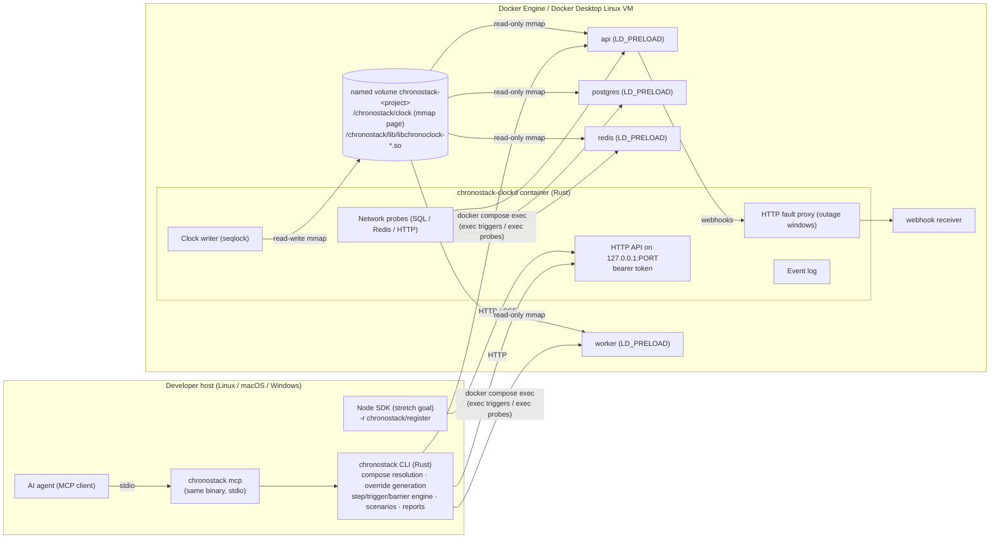

# ChronoStack — Architecture (proposed, v0.1)

Status: **proposal; not implemented.** Decisions are justified in [ARCHITECTURE_DECISIONS.md](ARCHITECTURE_DECISIONS.md). The evidence behind them is in [TECHNICAL_FEASIBILITY.md](TECHNICAL_FEASIBILITY.md) and [SOURCE_VERIFICATION.md](SOURCE_VERIFICATION.md).

> **M1 implementation note.** Probes moved entirely into the CLI (`docker compose exec`); clockd has no probe endpoint ([ADR-016 amendment](ARCHITECTURE_DECISIONS.md#adr-016--orchestration-runs-in-the-host-cli-no-docker-socket-in-containers)). Virtual time is monotonic-anchored ([ADR-017](ARCHITECTURE_DECISIONS.md#adr-017--virtual-time-is-anchored-to-clock_monotonic)). `/v1/clock/advance` takes `{"by_ns"}` or `{"to_unix_ns"}`.

> **Second-pass change (2026-11-13).** The step / trigger / barrier engine, `exec` triggers, scenarios and reports now run in the **host CLI**. The controller container (`clockd`) is reduced to five jobs: clock writer, small HTTP API, network probes, fault proxy and event log. As a result, no container needs the Docker socket ([ADR-016](ARCHITECTURE_DECISIONS.md#adr-016--orchestration-runs-in-the-host-cli-no-docker-socket-in-containers)). This resolves a contradiction between the first-pass ARCHITECTURE and SECURITY documents.

## 1. Component diagram



## 2. Components

| Component | Language | Responsibility |
|---|---|---|
| `chronostack` CLI | Rust | Resolves the Compose model (`docker compose config --format json`) and detects each image's architecture and libc. Writes `.chronostack/compose.override.yml` and starts/stops the stack. Runs the **step → trigger → barrier** engine, including `exec` triggers and probes through `docker compose exec`, plus sub-stepping. Runs scenarios, writes reports and renders output. |
| `chronostack mcp` | Rust (same binary) | MCP stdio server exposing a fixed, safe tool set. Calls the same engine as the CLI. |
| `chronostack-clockd` | Rust (container image) | The **only writer** of the clock page. Serves a minimal HTTP API, runs network probes (SQL/Redis/HTTP) from inside the Compose network, hosts the HTTP fault proxy, and keeps the event log. Copies shim `.so` files onto the volume at start. Has **no Docker socket**. |
| `libchronoclock` | C (4 builds: x86_64/aarch64 × glibc/musl) | Preloaded into target processes. Reads the page through a seqlock and virtualizes wall-clock reads. Translates absolute `CLOCK_REALTIME` deadlines and passes monotonic clocks through untouched. Fails open (or aborts in strict mode). |
| `chronostack/register` | JS (stretch goal for v0.1) | For Node processes running natively on the host: patches `Date` using the offset from clockd. |
| `chronostack.yml` | config | Declares triggers, barriers, probes, fault targets, scenarios and the sub-step limit. Optional; `up` and `advance` work without it. |

## 3. Time domains (explicit contract)

| Domain | Definition | Who changes it | Who reads it |
|---|---|---|---|
| **Virtual wall time** | `CLOCK_REALTIME(VM) + offset_ns`, or `frozen_virtual_ns` when frozen | clockd only | Shim (`clock_gettime(REALTIME/REALTIME_COARSE/TAI)`, `gettimeofday`, `time`, `timespec_get`), Node SDK |
| **Monotonic time** | Kernel `CLOCK_MONOTONIC`/`BOOTTIME` | Nobody (never virtualized) | Event loops, timers, timeouts, connection pools |
| **Scheduler time** | Each application's own "next run" | The application. ChronoStack influences it only through polling, triggers or the SDK. | App schedulers (pg_cron, BullMQ, Celery beat, …) |
| **Real elapsed time** | Time the developer actually waits | — | Barrier timeouts, dwell budget, reports |

Rule printed in docs and CLI help: *ChronoStack changes what time it **is**. It does not make time **pass** inside your timers. Use triggers or barriers for scheduled work.*

## 4. Control flow: `chronostack advance 14d --step 1d`

```mermaid
sequenceDiagram
  participant U as CLI engine (host)
  participant C as clockd
  participant V as clock page
  participant S as services
  loop for each step (1d), split into sub-steps of ≤ max_jump (default 1h if pg_cron is detected)
    U->>C: POST /v1/clock/advance {by: sub-step}
    C->>V: seq++ ; offset += by ; generation++ ; seq++
    C-->>U: {virtual_now, generation}
    U->>C: POST /v1/probe → SQL/Redis/HTTP skew
    U->>S: exec probes (docker compose exec … date) where configured
    U->>S: triggers declared for this step (exec via compose, HTTP)
    U->>S: barriers (SQL / Redis / HTTP / exec) until true or timeout
  end
  U-->>U: summary + report (.chronostack/report-<run>.json)
```

**Sub-stepping (new, source-verified need).** pg_cron evaluates only the current minute after a forward jump of more than 3 hours. A large jump therefore skips daily jobs ([SOURCE_VERIFICATION §2](SOURCE_VERIFICATION.md#2-postgresql-16)). The engine splits every step into sub-steps of at most `max_jump`:

- default `max_jump` is 1 h when pg_cron is detected in a Postgres service;
- otherwise no limit;
- the limit can be overridden in `chronostack.yml`.

If no triggers or barriers are configured, the engine falls back to `--dwell` (default 1 s, documented as best-effort). It also prints a warning naming the schedulers known to need more.

## 5. Data flow: one clock read in a target process

1. **First call.** The shim resolves the real functions with `dlsym(RTLD_NEXT)` (or `dlvsym` where symbol versions matter). It opens `CHRONOSTACK_CLOCK_PATH` (`/chronostack/clock`) read-only, maps it with `mmap(PROT_READ, MAP_SHARED)`, and validates `magic`, `layout_version` and `page_size`. On failure it fails open, or aborts if `CHRONOSTACK_STRICT=1`.
2. **Every call.** One real `clock_gettime(CLOCK_REALTIME)` (vDSO), one seqlock read, then add the offset.
3. **Fork safety.** Child processes inherit the mapping. The shim holds no locks.
4. **Hot path.** No allocation, no locks, and no syscalls beyond the real vDSO call.

## 6. Verifying that updates took effect

* **Probes** run after each committed change.
  * Network probes run in clockd: Postgres `SELECT extract(epoch from clock_timestamp())` and Redis `TIME`.
  * Exec probes run from the CLI: `docker compose exec <svc> date +%s` where available.
  * Users can define custom probes in `chronostack.yml`.
  * Skew greater than 1 s marks the service **not virtualized**. In strict mode this fails the step.
* **`chronostack doctor`** (CLI, using `docker compose exec`) checks each container:
  * whether `libchronoclock` appears in `/proc/1/maps`;
  * the detected libc and architecture;
  * whether the entrypoint is a static ELF binary.
* **Generation.** Every API response returns the page `generation`, and reports correlate events with it.

## 7. Failure modes

| Failure | Behaviour |
|---|---|
| clockd crashes | The page persists, services keep the last offset, and time flows at real rate. The CLI reports "controller unavailable". `chronostack up` restarts clockd, which then re-validates `session_id`. |
| Volume missing or page invalid in a service | Fails open to real time with one stderr line. Strict mode aborts. Doctor and probes catch it. |
| Writer killed mid-update (odd `seq`) | Readers retry a bounded number of times, then use their last good snapshot. clockd repairs `seq` on restart. |
| Barrier never becomes true | The step fails after `timeout` (default 30 s real time) and writes a failure report. The clock stays at the failed step. |
| Trigger command fails | The step fails. Output is captured, truncated and redacted. |
| Trigger command times out | The step fails (exit 4). The CLI kills its `docker` process tree and stops the trigger's process tree inside the container (TERM, then KILL after 3 s). Images without `sh` cannot be cleaned up this way; the report says so. |
| Fault proxy dies | Fails closed (connection refused), is logged as an event, and clockd restarts the proxy task. |
| Backward advance requested | Rejected in v0.1 (ADR-009). |

**Hard guarantee:** ChronoStack never calls `settimeofday` or `clock_settime`, never requests `CAP_SYS_TIME`, and never runs privileged containers. No container gets the Docker socket. The host and VM clocks are never modified.

## 8. clockd HTTP API (v1, bound to localhost)

| Method | Path | Purpose |
|---|---|---|
| GET | `/v1/health` | Liveness, no auth (used by the container healthcheck) |
| GET | `/v1/clock` | Returns `{virtual_ns, real_ns, offset_ns, frozen, generation, session_id, layout_version}` |
| POST | `/v1/clock/advance` | Takes `{by_ns}` or `{to_unix_ns}` (forward only). Performs a single atomic commit. |
| POST | `/v1/clock/freeze` / `/v1/clock/unfreeze` | Toggle the frozen state |
| PUT | `/v1/faults/{target}` / DELETE `/v1/faults/{id}` | *(planned, M3)* Outage windows (virtual-time ranges) on proxied targets |
| GET | `/v1/events?since=` | *(planned, M3)* Event log |
| GET | `/v1/stream` | *(planned, M4)* Server-sent events stream of clock changes (Node SDK) |

Stepping, triggers, barriers, scenarios and reports are **not** controller endpoints; the CLI engine owns them.

**Auth.** A random 256-bit token is written to `.chronostack/session.json` (mode 0600 on Unix; user-only ACL on Windows) and is required on every request. The API binds to `127.0.0.1` only.

## 9. Repository layout

```
crates/
  cli/            # chronostack binary: CLI, step/trigger/barrier engine, probes, doctor
                  # (scenarios, reports and MCP land here in M3–M4)
  clockd/         # controller: single clock writer, HTTP API
  core/           # shared: clock page layout, API types, compose model, planner, cron
shim/             # C preload library (built for glibc and musl inside docker/clockd.Dockerfile)
docker/           # controller image
examples/saas-trial-demo/
tests/e2e/        # Docker-based end-to-end tests, scheduler matrix, no-hang suite
spike/            # M0 feasibility spike (frozen, reference only)
docs/
```

Planned: `sdk/node/` (Node register, M4 stretch).
