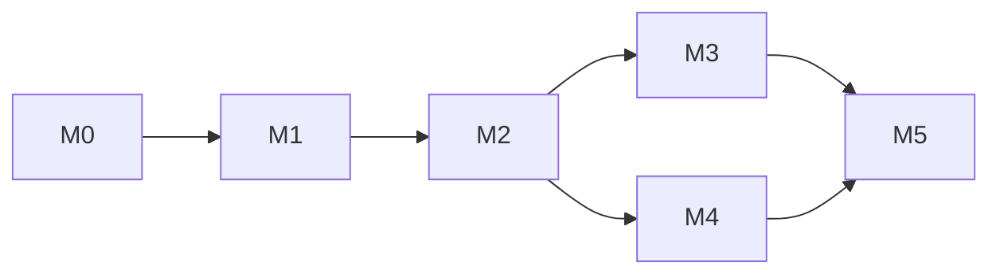

# ChronoStack — Implementation Plan (build order)

Realistic estimate: **10–12 weeks** for one experienced engineer. The original 28-day plan is not credible given the deadline-translation and scheduler problems found in research. Every milestone is a vertical slice with a hard exit gate. **Implementation must not start until explicitly authorized.**

---

## M0 — Feasibility spike (weeks 1–2)

> **Status (2026-11-13): exit gate passed on Docker Desktop/WSL2 x86_64.** See [M0_RESULTS.md](M0_RESULTS.md). Carried into M1: the macOS arm64 manual check, the arm64 rerun, and the clockd writer rules from ADR-017.

**Objective.** Prove or disprove the hardest assumptions before building product surface.

**Tasks.**
1. Minimal C shim: REALTIME read virtualization + seqlock page reader; then deadline translation for `sem_timedwait`, `pthread_mutex_timedlock`, `pthread_cond_timedwait` (+ condattr tracking), `clock_nanosleep`, `timerfd_settime`, `timer_settime`, `*_clockwait`.
2. Build with `zig cc` for x86_64/aarch64 × gnu/musl.
3. Tiny Rust writer binary (`spike-writer set-offset 7d`) running in a container that owns a named volume.
4. Hand-written compose file: postgres:16, postgres:16-alpine, redis:7, redis:7-alpine, node:22, node:22-alpine, python:3.10, python:3.12, eclipse-temurin:21, ruby:3.3, plus a Go binary (negative).
5. Run the same matrix with libfaketime (`FAKETIME_TIMESTAMP_FILE`) as an oracle/baseline.
6. pg_cron's clock-jump logic is already source-verified (see SOURCE_VERIFICATION §2): confirm it experimentally (PG-7..9) and confirm `MINUTE_COUNT`. Read BullMQ's worker wake logic in source (not documented publicly).
7. Run on Linux x86_64 and Docker Desktop macOS arm64 (and OrbStack if available).

**Files.** `spike/` only (throwaway; deleted or moved to `shim/` after the gate).
**Dependencies.** zig, Docker, libfaketime (test only).
**Deliverable.** `docs/M0_RESULTS.md`: pass/fail per test with logs.
**Automated tests.** Shell/pytest harness running PG-1..11, RD-1..6, RT-*, NOHANG-*, NEG-1..2.
**Manual.** Watch `top` for spinning processes; verify Postgres starts/stops cleanly under shim.
**Acceptance.** Wall time correct (±1 s) in all "supported target" images on both platforms; **zero hangs** in the no-hang suite for Postgres, Redis, Node, Python 3.11+; shim overhead measured.
**Risks.** Deadline translation incomplete; glibc symbol-version issues; Docker Desktop volume behaviour.
**Exit gate.** If any supported-target runtime hangs and cannot be fixed within the spike → **reduce scope** (drop that runtime) and update MVP_SCOPE before continuing. If wall-time virtualization fails on Docker Desktop → stop and redesign.

## M1 — Controller, CLI core, compose integration (weeks 3–4)

> **Status (2026-11-13): implemented.** Workspace: `crates/{core,clockd,cli}` and `shim/`. The e2e test (`tests/e2e/run_m1.py`) passes locally on Docker Desktop/WSL2 and runs in CI on Linux x86_64 and arm64. Differences from the original plan:
> - probes run through `docker compose exec` from the CLI, so clockd has no `/v1/probe` endpoint and needs no database credentials (ADR-016 amendment);
> - the glibc shim is built with zig against glibc 2.17, so it loads in older images such as Debian bullseye (pulled forward from M5);
> - the CLI re-resolves the controller port if `clockd` restarts.
>
> **Exit gate passed:** 3 unmodified external projects from docker/awesome-compose. See [M1_RESULTS.md](M1_RESULTS.md). This found and fixed a `doctor` false-healthy for Go processes behind a supervisor.

**Objective.** `chronostack up && chronostack advance 7d && chronostack now` on any unmodified compose project.

**Tasks.** Cargo workspace (`crates/core`, `crates/clockd`, `crates/cli`); page layout in `core` + layout test vs C header; clockd HTTP API (`/v1/clock`, `/v1/clock/advance`, `/v1/clock/freeze`, `/v1/clock/unfreeze`, `/v1/probe`); `doctor` in the CLI via `docker compose exec`; token auth; compose resolution via `docker compose config --format json`; image arch/libc detection with digest cache; override generator (preserve existing `LD_PRELOAD`); `up/down/now/advance/freeze/doctor/probe` commands; automatic probes.
**Files.** `crates/*`, `shim/` (promoted from spike), `docker/clockd.Dockerfile`.
**Dependencies.** tokio, axum (or hyper), serde/serde_json, clap, reqwest — to be confirmed at implementation time.
**Deliverable.** Working CLI against an arbitrary compose file.
**Automated tests.** Unit: duration parsing, override generation snapshots (insta), env merging, layout test, seqlock property tests (loom or multi-thread stress). Integration: up/advance/probe on the M0 matrix.
**Manual.** Run on 3 real-world open-source compose projects (one Node, one Python, one with alpine images).
**Acceptance.** Probes report ≤ 1 s skew for all virtualizable services; doctor correctly flags a Go service; override never modifies user files; `down` removes volume/containers.
**Risks.** Compose edge cases (`network_mode: service:`, `build:` without image, profiles).
**Exit gate.** 3 external projects work without modification.

## M2 — Step / trigger / barrier + reference app (weeks 5–7)

> **Status (2026-11-13): implemented.** See [M2_RESULTS.md](M2_RESULTS.md).
> - `chronostack.yml` with scheduled triggers and barriers; planner; engine; pg_cron auto sub-stepping; demo app.
> - e2e in CI. Locally: 3/3 identical demo runs, and `advance 14d` takes 17.5 s.
>
> Gaps: 10-run and macOS determinism, scheduler matrix (BullMQ/Celery/node-cron), R13.

**Objective.** The 14-day trial lifecycle runs end-to-end, reproducibly.

**Tasks.** `chronostack.yml` schema + validation (JSON Schema published); engine in the host CLI (ADR-016): triggers (`exec` via `docker compose exec`, `http`); barriers (`sql`, `redis`, `http`, `exec`) with timeouts; stepped advance with automatic sub-stepping (`max_jump`, pg_cron detection); per-step results streamed; `examples/saas-trial-demo`; scheduler matrix tests (BullMQ, Celery beat, pg_cron, node-cron negative).
**Files.** `crates/core/src/config.rs`, `crates/cli/src/engine/*`, `examples/saas-trial-demo/*`, `tests/schedulers/*`.
**Deliverable.** `chronostack advance 14d --step 1d` downgrades the demo user with 14 daily-job runs.
**Automated tests.** Demo acceptance script in CI (Linux); scheduler matrix; barrier timeout tests.
**Manual.** macOS Docker Desktop run; timing measurement.
**Acceptance.** 10 consecutive runs produce identical outcomes (job counts, final states); total wall time < 60 s for 14 steps on CI hardware (target, to be measured).
**Risks.** Flaky barriers; worker startup races.
**Exit gate.** 10/10 identical runs on Linux and 3/3 on macOS.

## M3 — Webhook outage windows, scenarios, failure reports (weeks 8–9)

**Objective.** Test retry logic across a virtual-time outage and capture reproducible failure artifacts.

> **Status (2026-11-14): implemented; exit gate met locally.** See [M3_RESULTS.md](M3_RESULTS.md). Differences from the plan: windows return an HTTP status (no "connection refused" mode); faults are `POST /v1/faults` with ids; scenario parsing lives in `crates/cli/src/scenario.rs` next to the config parser.

**Tasks.** HTTP reverse proxy in clockd for declared egress targets; outage windows keyed to virtual time; override rewrites target URLs via env (`WEBHOOK_URL`) or network alias; linear scenario runner (`advance`, `trigger`, `http`, `assert_sql`, `assert_redis`, `fault`); report JSON (scenario, clock log with generations, probe results, trigger output (redacted), proxy event ring buffer last 1 000).
**Files.** `crates/clockd/src/proxy.rs`, `crates/core/src/scenario.rs`, `crates/cli/src/report.rs`.
**Deliverable.** `chronostack run scenarios/trial.yml` → pass/fail + report.
**Automated tests.** Proxy unit tests; scenario parser tests; demo scenario with deliberate failure → report contents asserted.
**Acceptance.** Webhook retried after outage and delivered exactly once (idempotency asserted by receiver).
**Risks.** Apps that hard-code external URLs (documented: requires env-configurable URL or alias).
**Exit gate.** Deliberate-bug demo produces a report a new developer can understand without reading code.

## M4 — MCP server + Node register (week 10)

**Objective.** Agents can drive the timeline; host-native Node apps stay in sync.

**Tasks.** MCP stdio server (ADR-011 tool set, current spec revision pinned); tool schemas; Node `register` (patch `Date`, `Date.now`, `new Date()` with SSE-synced offset; `onAdvance` hook); docs for Claude Code/Cursor config.
**Files.** `crates/cli/src/mcp/*`, `sdk/node/*`.
**Automated tests.** MCP protocol conformance tests (initialize, tools/list, tools/call); Node SDK unit tests (offset application, reconnect).
**Manual.** Claude Code session: "verify webhook retry behavior during a 2-hour outage" — confirm the agent uses `fault_set` → `clock_advance` → `fault_clear` → `events_tail`.
**Acceptance.** Manual agent run succeeds 3/3; SDK keeps host Node within 50 ms of virtual time.
**Risks.** Agent tool misuse → mitigated by safe tool set.
**Exit gate.** Both demos recorded.

## M5 — Release (weeks 11–12)

**Objective.** Installable v0.1 with honest docs.

**Tasks.** Release process per [development/RELEASE_PROCESS.md](development/RELEASE_PROCESS.md): shim builds (zig), CLI for linux-x64/arm64 and darwin-arm64/x64 (cargo-zigbuild), win32-x64 (native Windows runner); clockd multi-arch image on GHCR; checksums + SBOM; install script; README (positioning, 60-second demo, compatibility table generated from test results, limitations); 20-second terminal recording; CONTRIBUTING; SECURITY.md.
**Automated tests.** Release smoke test: fresh VM → install → demo acceptance.
**Acceptance.** Fresh Linux and macOS machines run the demo in < 5 minutes from zero.
**Exit gate.** Tag v0.1.0.

---

## Dependency graph

## Timeline risk buffer

Add 2 weeks contingency (M0 may require iteration on deadline translation). Realistic v0.1 date: 12–14 weeks after authorization.
